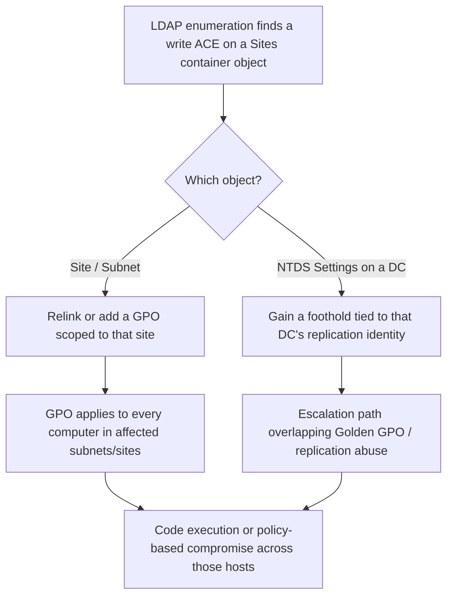

# AD Sites & Services ACL abuse

Active Directory Sites & Services objects (sites, subnets, site links, and the NTDS Settings
objects on each domain controller) are configuration containers for replication topology — a
part of AD that is routinely overlooked when administrators review "who can change what."
Like any other AD object, they carry their own ACLs, and an overly broad write right on them
is a privilege-escalation path in the same family as [ACL abuse](acl_abuse.md), just on a
less-audited corner of the directory.

> **Authorized assessment only:** This guide describes controlled, explicitly authorized
> assessment and defensive validation. It contains no target commands, exploit recipes,
> payloads, guessing parameters or real-target procedure.

## Beginner-friendly walkthrough

**In plain terms:** think of Sites & Services as the directory's internal "map and delivery
schedule" — which office (site) is on which network (subnet), and which route (site link)
replication traffic takes between domain controllers. Almost nobody reviews permissions on
this map, because it looks like plumbing rather than a security boundary. But some of the
objects on it — in particular a domain controller's own NTDS Settings object and GPOs linked
at the site level — can be abused by anyone who is quietly handed write access to them,
exactly like any other ACL-abuse finding.

**Objects abused / affected**

| Object | Normal purpose | How it's abused |
| --- | --- | --- |
| Site object | Groups subnets that share fast network connectivity | A write right lets an attacker relink GPOs scoped to that site to any OU or object within it |
| Subnet object | Maps IP ranges to a site | Misassigning a subnet can change which site-scoped GPOs and replication behavior a host receives |
| Site-Link object | Defines replication cost/schedule between sites | Write access can be used to manipulate replication timing, which complicates detection and recovery |
| NTDS Settings object (on a DC's server object) | Represents that DC's replication connections | Excess write rights here overlap with the broader "control over a domain controller" class of findings |

**Stages, and which tool typically covers each one**

1. **Find the edge** — this is a less common finding than user/group ACL abuse, so it's easy to
   miss with manual review; `BloodHound`'s edge collection (via `SharpHound`/`AzureHound`-style
   collectors) and `PowerView`'s generic ACL cmdlets both walk Configuration-partition objects,
   including Sites & Services, and will surface an unusual ACE here the same way they would on
   a user object.
2. **Exercise the right** — once an edge is confirmed, `BloodyAD`'s generic attribute/ACL
   write support can act on Configuration-partition objects the same way it does on
   domain-partition objects.
3. **Chain onward** — a write right on a site's linked GPO set overlaps with
   [GPO abuse](gpo_abuse.md); a write right on a DC's NTDS Settings object overlaps with the
   broader domain-controller compromise findings in this graph.

## Prerequisite chain

The principal needs an effective write or owner right on a Sites & Services object (resolved
after inheritance and nested-group membership, same as any other ACL finding), and the target
object must actually be in active use (a linked GPO, a subnet mapped to a populated site, or a
live DC's NTDS Settings object) for the right to matter operationally.

## Impact limits and failure cases

The Configuration partition is less frequently reviewed than the domain partition, but it is
also smaller and more static — unusual ACEs here are often easier to baseline once a team knows
to look. Not every Sites & Services object is operationally significant: a subnet mapped to no
live hosts, or a site link with no attached GPOs, carries little practical impact even with an
excess write right.

## Detection and validation

Monitor directory audit event 5136 scoped to the Configuration partition (sites, subnets,
site links, and NTDS Settings objects specifically), and correlate with GPO link changes
(5136 on `gPLink`/`gPOptions`) and DC-object changes. Baseline the (normally very small) set of
tier-0 administrators who legitimately touch this part of the directory, since routine change
volume here should be close to zero.

## Mitigation and recovery

**Mitigation:** Include the Configuration partition in regular ACL review alongside the domain
partition; remove unnecessary delegated rights on sites, subnets, site links, and DC server
objects; treat NTDS Settings objects as tier-0 assets.

**Recovery:** Preserve evidence, isolate affected systems and identities, remove unauthorized
ACEs or GPO links through approved procedures, review relevant credentials/sessions and retest
in a clean lab.

## References

- [Microsoft: Active Directory replication concepts](https://learn.microsoft.com/windows-server/identity/ad-ds/get-started/replication/active-directory-replication-concepts)
- [Microsoft: Security auditing](https://learn.microsoft.com/windows/security/threat-protection/auditing/security-auditing-overview)
- [MITRE ATT&CK: T1484.001](https://attack.mitre.org/techniques/T1484/001/)
