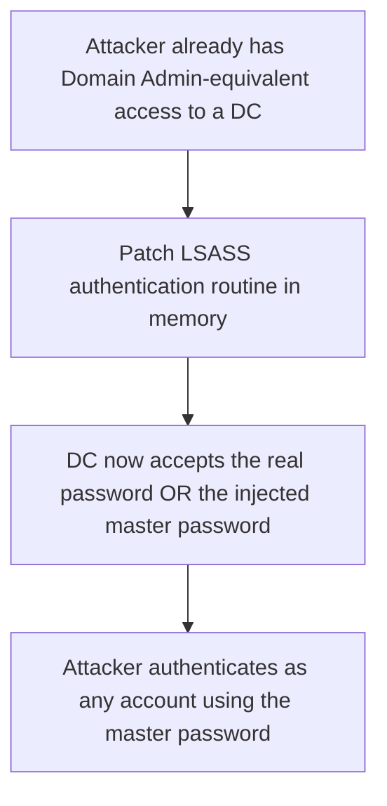

# Skeleton key

A skeleton-key condition alters live DC/KDC authentication in memory. It is an integrity incident, not a normal Kerberos account or ticket artifact.

> **Authorized assessment only:** This guide describes controlled, explicitly authorized assessment and defensive validation. It contains no target commands, exploit recipes, payloads, guessing parameters or real-target procedure.

## Beginner-friendly walkthrough

**In plain terms:** this patches the domain controller's authentication process *in memory* so that, from then on, it accepts a secret master password for **every** account, in addition to each account's real password. It's the equivalent of a locksmith secretly fitting every lock in the building with a master key that opens them all, without the actual key owners noticing their own keys still work too.

**Objects abused / affected**

| Object | Normal purpose | What this technique touches |
| --- | --- | --- |
| `lsass.exe` on a domain controller | Handles live authentication decisions | Patched in memory to also accept an attacker-chosen master password |
| Every domain account | Authenticates with its own password | Now *also* authenticates with the injected master password, silently |

**Stages, and which tool typically covers each one**

1. **Prerequisite** — this requires admin-equivalent access to a DC already; it is a persistence technique, not an escalation technique.
2. **Patch in memory** — `Mimikatz`'s skeleton-key module is the best-known implementation; because the change lives only in memory, it does not survive a DC reboot (which is also why it's a weaker persistence method than a golden ticket).
3. **Why it matters for defense** — the required condition (LSASS memory modification on a domain controller) is itself extremely rare and high-signal, so detection should focus on catching the patch attempt, not the logons that follow it.

Because this is pure in-memory tampering with a production authentication process on a domain controller, it is also one of the riskiest techniques to validate in a live environment — a lab-only exercise unless explicitly scoped and approved.

## Relevant objects and normal purpose

DC LSASS/KDC process, account database/KRBTGT context, process integrity/PPL/HVCI/EDR, KDC modules and DC reboot/process state are central.

## Prerequisite chain

Authorized lab or incident control of a DC plus ability to modify/load the live authentication process is required. A reboot/restart or patch may remove it.

## Impact limits and failure cases

OS protections, architecture, patch/HVCI/PPL/EDR, KDC process state and DC restart determine existence and survival. It is highly privileged and transient rather than a persistent secret.

## Detection and validation

Alert on LSASS/KDC memory/process/module integrity changes, KDC restarts, anomalous AS exchanges and DC EDR tampering. Preserve DC memory and process evidence.

Validate an impact hypothesis by correlating the relevant identity, directory, authentication, endpoint, network or cloud telemetry for the exact host, account and time. One event ID or tool label is not proof of success.

## Mitigation and recovery

**Mitigation:** Tier and isolate DC administration, apply HVCI/PPL/EDR/application control and patch DCs.

**Recovery:** Preserve evidence, isolate affected systems and identities, remove unauthorized state through approved procedures, review relevant credentials/sessions and retest in a clean lab.

## References

- [Microsoft: Kerberos authentication overview](https://learn.microsoft.com/windows-server/security/kerberos/kerberos-authentication-overview)
- [Microsoft: Credential protection](https://learn.microsoft.com/windows-server/security/credentials-protection-and-management/credential-protection-and-management)
- [Microsoft: Active Directory Domain Services](https://learn.microsoft.com/windows-server/identity/ad-ds/)
- [Microsoft: Security auditing](https://learn.microsoft.com/windows/security/threat-protection/auditing/security-auditing-overview)
- [MITRE ATT&CK: T1556.001](https://attack.mitre.org/techniques/T1556/001/)
