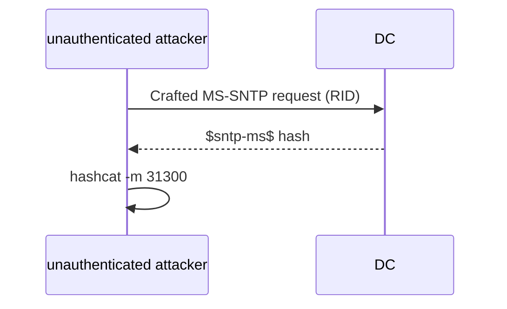

# Timeroasting

### Affected object / attribute
**MS-SNTP authentication** — computer and trust accounts.

### Concept (deep)
MS-SNTP auth uses a checksum keyed by the **computer account password**. Unauthenticated crafted NTP requests to a DC yield `$sntp-ms$` hashes for **all computer accounts** (and sometimes gMSA) → crack with hashcat **31300**.

### Attack flow (Mermaid)


### Commands
```bash
