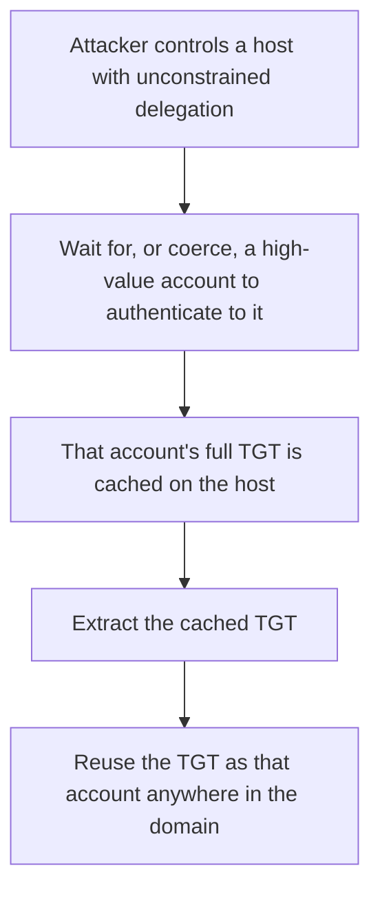

# Unconstrained delegation abuse

Unconstrained delegation lets a configured host cache TGTs for users who authenticate to it, creating a sensitive host trust boundary.

> **Authorized assessment only:** This guide describes controlled, explicitly authorized assessment and defensive validation. It contains no target commands, exploit recipes, payloads, guessing parameters or real-target procedure.

## Beginner-friendly walkthrough

**In plain terms:** a host configured for unconstrained delegation is allowed to hold onto a full copy of any user's Kerberos ticket (TGT) the moment that user authenticates to it — not just a limited token for one service, but the user's *entire* ticket, reusable anywhere. If an attacker controls that host, they can wait (or actively trick a high-value account into connecting) and then simply take the cached ticket.

**Objects abused / affected**

| Object | Normal purpose | What this technique touches |
| --- | --- | --- |
| Computer account with `TRUSTED_FOR_DELEGATION` flag | Lets a legitimate multi-hop service (e.g. a file server impersonating users to a backend) work | Means any TGT cached on that host can be lifted by whoever controls the host |
| Cached TGTs of users/computers who authenticate to that host | Normal delegation working memory | Become directly reusable by the attacker |
| Domain controller computer accounts | DCs authenticate to each other routinely | A classic high-value target if an attacker can coerce a DC to authenticate to their unconstrained-delegation host |

**Stages, and which tool typically covers each one**

1. **Find delegation-enabled hosts** — surfaced during [LDAP enumeration](ldap_enum.md) by checking the relevant `userAccountControl` flag on computer objects.
2. **Coerce authentication (if not waiting naturally)** — `PetitPotam` and similar coercion techniques can trigger a privileged computer account (sometimes a DC) to authenticate to the attacker-controlled host.
3. **Capture and reuse the ticket** — `Rubeus`'s ticket-monitoring/extraction features pull the cached TGT once it lands; `krbrelayx` can also relay the coerced authentication directly rather than only capturing it.

The fix is structural, not detective: move affected hosts to constrained (or resource-based constrained) delegation, which limits exactly which service the cached ticket can be used for instead of handing over the whole TGT.

## Relevant objects and normal purpose

Computer account `TRUSTED_FOR_DELEGATION` flag, host TGT cache, SPNs, authentication protocol/source, krbtgt/KDC, account “sensitive/not delegatable” state and Protected Users are central.

## Prerequisite chain

The host must be unconstrained-delegation configured and receive authentication from an account whose ticket is cached. Host control and the ticket remaining usable are required.

## Impact limits and failure cases

Protected Users/not-delegated/sensitive accounts, ticket lifetime, authentication flags and host control limit impact. User TGT scope is not automatically privileged.

## Detection and validation

Monitor delegation flag/SPN changes, privileged 4624/4768 to delegated hosts and LSA/cache access. Correlate account, source host and ticket lifetime.

Validate an impact hypothesis by correlating the relevant identity, directory, authentication, endpoint, network or cloud telemetry for the exact host, account and time. One event ID or tool label is not proof of success.

## Mitigation and recovery

**Mitigation:** Remove unconstrained delegation, use constrained/resource-based patterns, mark sensitive accounts not delegatable and isolate delegated hosts.

**Recovery:** Preserve evidence, isolate affected systems and identities, remove unauthorized state through approved procedures, review relevant credentials/sessions and retest in a clean lab.

## References

- [Microsoft: Kerberos authentication overview](https://learn.microsoft.com/windows-server/security/kerberos/kerberos-authentication-overview)
- [Microsoft: Credential protection](https://learn.microsoft.com/windows-server/security/credentials-protection-and-management/credential-protection-and-management)
- [Microsoft: Active Directory Domain Services](https://learn.microsoft.com/windows-server/identity/ad-ds/)
- [Microsoft: Security auditing](https://learn.microsoft.com/windows/security/threat-protection/auditing/security-auditing-overview)
- [MITRE ATT&CK: T1558](https://attack.mitre.org/techniques/T1558/)
