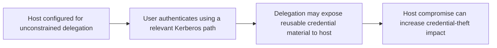

# Unconstrained delegation

## Concept

Kerberos delegation allows a service to access another service on behalf of a user. With unconstrained delegation, a service host trusted for delegation can receive reusable Kerberos credentials when a user authenticates to it using Kerberos, rather than being limited to a specified backend service. This creates a substantial exposure if the host is compromised and privileged users can authenticate to it.

The risk depends on protocol, authentication path, account settings, and operating-system protections. It is inaccurate to assume every authentication delivers a full reusable TGT in every circumstance. The assessment should distinguish configured trust from evidence that sensitive credentials were actually present or accessed.

## Prerequisites and affected assets

Review computer and service accounts with the unconstrained-delegation trust setting, excluding or separately evaluating domain controllers and documented exceptions. Identify host owners, services, privileged-user access patterns, inbound authentication protocols, and protections for credentials on the host. A compromised delegation host is a prerequisite for credential access; configuration alone is a risk indicator, not proof of compromise.

Do not induce privileged authentication or use coercion techniques as part of routine validation. Such actions can disrupt services and may exceed an engagement’s authorization.

## Detection

Inventory delegation settings and alert on unauthorized changes to trust-for-delegation flags. On hosts where delegation is justified, monitor credential-access telemetry, suspicious access to authentication processes, unexpected ticket activity, and privileged logons from unusual sources. Correlate domain-controller events (including relevant 4624 and 4768 records) with endpoint evidence. Event patterns alone cannot reliably prove ticket extraction; audit and platform capabilities vary.

## Remediation

Remove unconstrained delegation where it is not required and migrate to constrained delegation or RBCD only after reviewing the service’s actual needs and target policy. Protect sensitive accounts from delegation, reduce privileged interactive logons to servers, apply tiered administration, and harden hosts that must retain delegation. Coordinate changes with service owners to avoid authentication outages.

## Limits and related topics

This page describes exposure and defensive review, not credential capture or coercion procedures. See [constrained delegation](constrained_deleg.md), [RBCD](rbcd.md), and [coercion and relay](coerce_relay.md).
