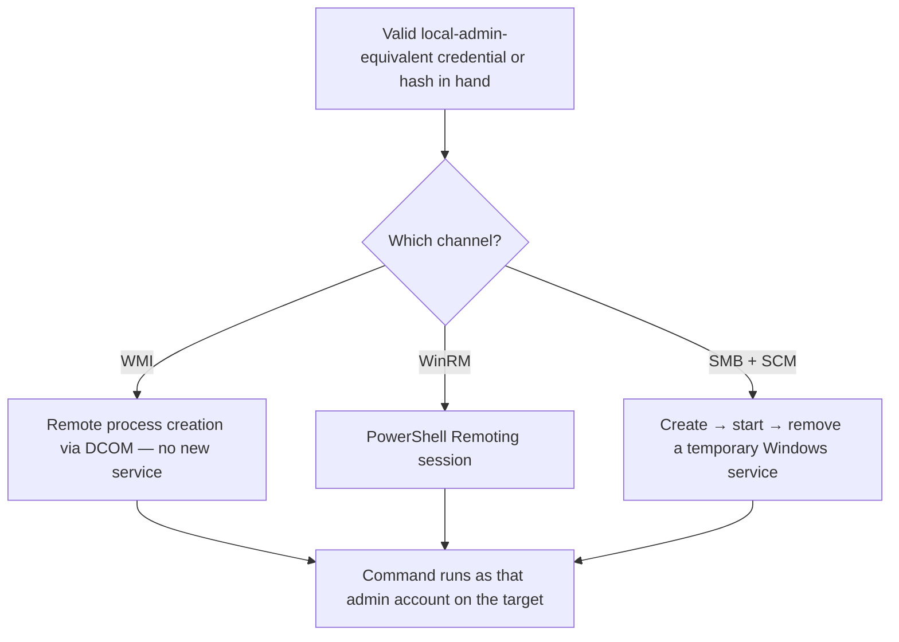

# WMI / WinRM / SMB remote execution

WMI/WinRM/SMB remote management can create CIM sessions, processes or services. The protocols and authorization boundaries are distinct and should be validated separately.

> **Authorized assessment only:** This guide describes controlled, explicitly authorized red-team assessment, lab practice, and defensive validation. It contains no target commands, exploit recipes, payloads, guessing parameters or real-target procedure.

## Beginner-friendly walkthrough

**In plain terms:** once you have valid credentials (or a hash) for an account with local admin rights on a target, Windows gives you several completely legitimate remote-management channels (WMI, WinRM, SMB-based service creation) to run commands on that machine. Attackers simply use the exact same admin channels that IT departments use every day — the technique isn't really the clever part; having the credentials is.

**Objects abused / affected**

| Channel | Normal purpose | How it's used here |
| --- | --- | --- |
| WMI (DCOM) | Remote system management, inventory, scripting | Can start a process remotely with no new service/file artifacts on disk |
| WinRM (PowerShell Remoting) | Remote PowerShell administration | Opens an interactive or scripted PowerShell session on the target |
| SMB + Service Control Manager | File transfer and legitimate service installation | A temporary service is created, started (runs the command), then removed |

**Stages, and which tool typically covers each one**

1. **Prerequisite** — a credential or hash with local admin rights on the target, usually from [pass-the-hash](pth.md) or a normal credential-access step.
2. **Pick the channel** — `Impacket`'s SMB/WMI-focused scripts and `NetExec` both support all three channels from Linux; `Evil-WinRM` is purpose-built for the WinRM/PowerShell-Remoting channel specifically.
3. **Why detection differs by channel** — SMB-based execution leaves a 7045 "service installed" event and a 4688 process-creation event; WMI leaves entries in the WMI-Activity operational log; WinRM leaves distinct session logs — a blue team watching only one channel will miss the other two.

None of these channels is itself a vulnerability — they are intended administrative features. The actual finding worth fixing is almost always "why does this account have local admin on this box," not "how did they run a command once they had it."

## Relevant objects and normal purpose

WMI namespace/provider/DCOM ACL, WinRM listener/HTTP(S), SMB/DCOM, account logon/token, remote-UAC, process/service logs, firewall and endpoint policy are relevant.

## Prerequisite chain

Valid remote credentials/token, protocol reachability and local rights to the listener/namespace/provider/action are required.

## Impact limits and failure cases

Remote UAC, listener/auth, namespace/provider ACL, DCOM/SMB policy, account type, token integrity and endpoint controls determine process/service privilege. Protocol success is not automatic execution privilege.

## Detection and validation

Correlate WMI-Activity, 4688 process, 7045 service, 4624 type 3/logon and WinRM logs with account/source and target action.

Validate an impact hypothesis by correlating the relevant identity, directory, authentication, endpoint, network or cloud telemetry for the exact host, account and time. One event ID or tool label is not proof of success.

## Mitigation and recovery

**Mitigation:** Restrict management protocols and sources, use JEA/WinRM ACL, tier administration and endpoint control.

**Recovery:** Preserve evidence, isolate affected systems and identities, remove unauthorized state through approved procedures, review relevant credentials/sessions and retest in a clean lab.

## References

- [Microsoft: Windows authentication overview](https://learn.microsoft.com/windows-server/security/windows-authentication/windows-authentication-overview)
- [Microsoft: SMB security](https://learn.microsoft.com/windows-server/storage/file-server/smb-security)
- [MITRE ATT&CK: T1047](https://attack.mitre.org/techniques/T1047/)
- [MITRE ATT&CK: T1021.002](https://attack.mitre.org/techniques/T1021/002/)
- [MITRE ATT&CK: T1021.006](https://attack.mitre.org/techniques/T1021/006/)
